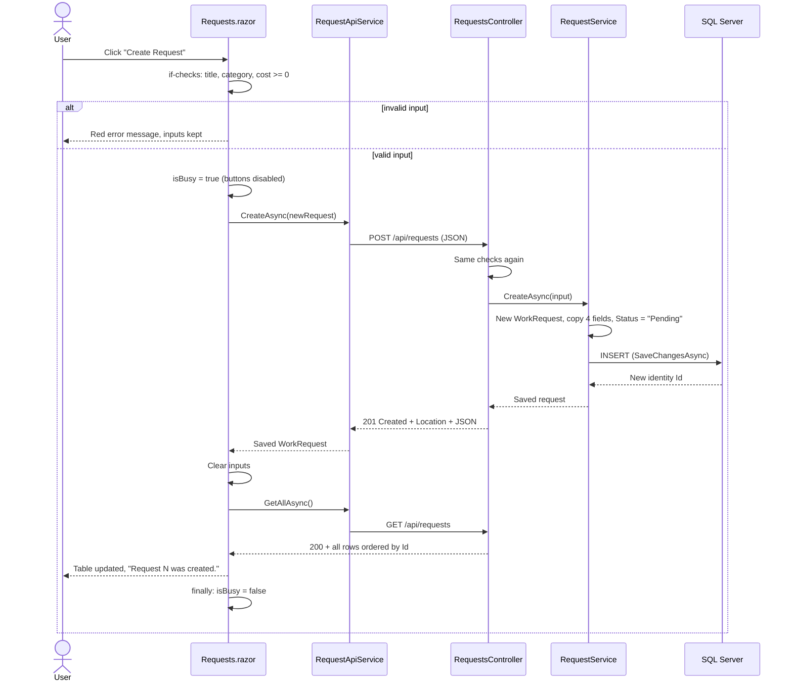
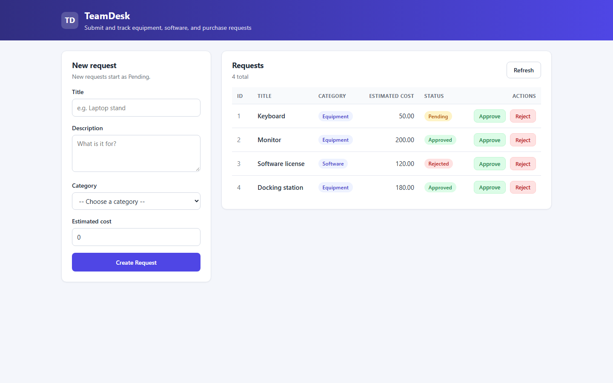
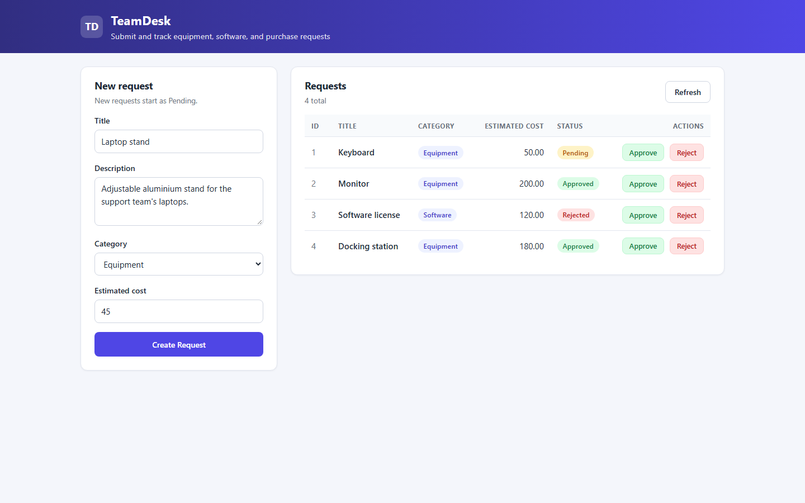
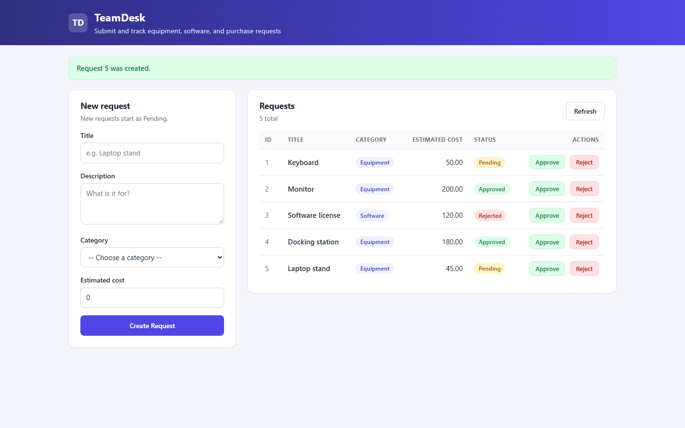
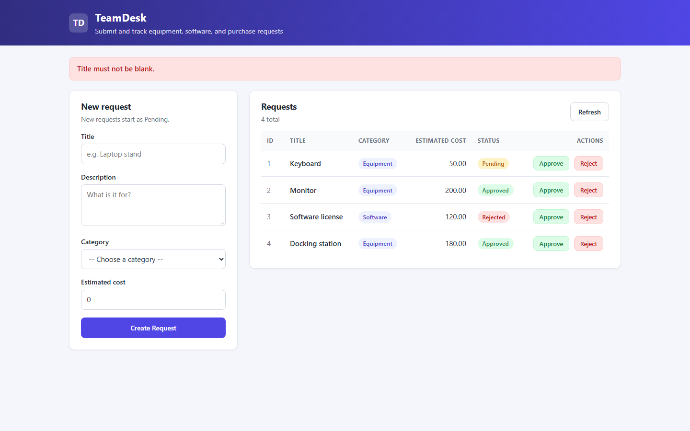
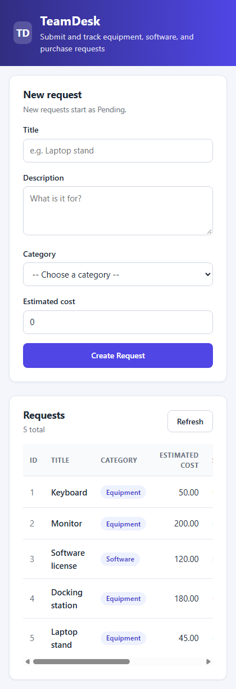
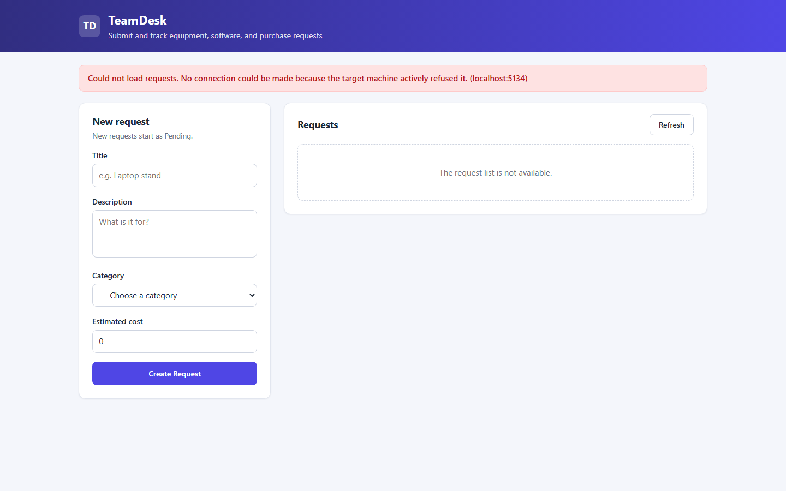

# TeamDesk — Request Tracking

A small request-tracking web application for one organization. Employees submit requests for
equipment, software, purchases, or other needs; each request is stored in SQL Server and moves
between `Pending`, `Approved`, and `Rejected`.

ASP.NET Core controller API · Entity Framework Core 10 on SQL Server · Blazor Web App with
Interactive Server rendering · .NET 10.


This is a learning project built in three phases. It runs locally only; there is no hosted demo.
All data shown is fictional sample data.

<p align="center">
  <a href="docs/screenshots/status-updated.png">
    
  </a>
</p>

## Table of contents

- [Overview](#overview)
- [Key features](#key-features)
- [Engineering highlights](#engineering-highlights)
- [System architecture](#system-architecture)
- [Request lifecycle](#request-lifecycle)
- [Data model](#data-model)
- [Technology stack](#technology-stack)
- [Validation and safety](#validation-and-safety)
- [Screenshots](#screenshots)
- [Verification](#verification)
- [API reference](#api-reference)
- [Local setup](#local-setup)
- [Configuration](#configuration)
- [Project structure](#project-structure)
- [Build phases](#build-phases)
- [Known limitations](#known-limitations)
- [Future improvements](#future-improvements)

## Overview

TeamDesk is two ASP.NET Core applications in one solution, `TeamDesk.slnx`:

- **`src/TeamDesk.Api`** — a controller-based REST API. `RequestsController` validates input and
  delegates to `RequestService`, which reads and writes the `WorkRequests` table through an EF Core
  `AppDbContext`.
- **`src/TeamDesk.Web`** — a Blazor Web App with a single interactive page. It never touches the
  database; every read and write goes through `RequestApiService`, a typed `HttpClient` that calls
  the API.

A user fills in the form on the Requests page and presses **Create Request**. The page validates the
input, the service posts JSON to the API, the API validates again, saves a new row with an
identity-generated Id and the status `Pending`, and answers `201 Created`. The page then reloads the
list from the API so the table always shows what the database actually holds.

The code is deliberately plain: ordinary classes and properties, constructor injection, explicit
methods, and simple `if` statements instead of clever abstractions. It is written to be read by a
developer coming from C++ who has just learned C# and ASP.NET Core.

## Key features

- **Create requests** with a title, description, category (Equipment or Software), and estimated
  cost. The server assigns the Id and always starts a request as `Pending`.
- **Approve or reject** any request from its table row; the change is saved before the table
  updates.
- **Persistent storage** in a dedicated SQL Server database, `TeamDeskLearning`, created by an EF
  Core migration.
- **Validation on both sides** — the page catches blank titles, a missing category, and negative
  costs before sending; the API enforces the same rules and rejects unknown statuses.
- **Honest loading and error states** — a loading message while fetching, an empty message only
  when the API really returned no rows, and a readable error (not a fake empty list) when the API
  cannot be reached.
- **Refresh** button to reload the list, which also recovers the page after the API comes back.

## Engineering highlights

- **Thin controller, explicit service.** `RequestsController` does only HTTP work — validation with
  plain `if` statements and choosing a status code. All queries and `SaveChangesAsync` calls live in
  `RequestService`, which receives `AppDbContext` through its constructor. Both are registered with
  the built-in DI container (`AddDbContext`, `AddScoped<RequestService>`).

- **Server-owned Id and status.** `CreateAsync` builds a *new* `WorkRequest` and copies only
  `Title`, `Description`, `Category`, and `EstimatedCost` from the input. A client that posts
  `"id": 99, "status": "Approved"` still gets a database-generated Id and `Pending` — this was
  checked against the live API.

- **Explicit validation instead of hidden rules.** With nullable reference types enabled,
  `[ApiController]` would silently treat every non-nullable `string` as `[Required]` and reject a
  POST that omits `Status`. `Program.cs` turns that implicit rule off
  (`SuppressImplicitRequiredAttributeForNonNullableReferenceTypes`) so the readable `if` checks in
  the controller are the single source of validation.

- **Correct money column.** `[Precision(18, 2)]` on `EstimatedCost` makes EF Core create a
  `decimal(18,2)` column — 18 digits in total, 2 after the decimal point — instead of a provider
  default.

- **201 with a Location header.** `POST /api/requests` returns `CreatedAtAction(nameof(GetById),
  …)`, so the response carries `Location: http://localhost:5134/api/requests/{id}` pointing at the
  new row.

- **Failures are never mistaken for data.** `RequestApiService` checks every response. A non-success
  status becomes an `HttpRequestException`; for a `400` it includes the API's short explanation,
  while other error bodies (which can be stack traces in Development) are not shown. The page keeps
  a separate `listLoaded` flag so "the API is down" and "there are no requests" render differently.

- **No stuck buttons.** Every page action sets an `isBusy` flag that disables the buttons and clears
  it in a `finally` block, so a failed call cannot leave the page disabled. Entered form values are
  kept when a save fails and cleared only after the API confirms the save.

- **Schema changes through migrations only.** The `WorkRequests` table is created by the
  `InitialCreate` migration with the pinned `dotnet-ef` local tool. The app never runs migrations or
  inserts sample data on startup.

- **No secrets in the repository.** The committed connection string targets LocalDB with Windows
  authentication (no password). A password-based server is configured through .NET user secrets or
  the `ConnectionStrings__TeamDesk` environment variable.

## System architecture

```mermaid
flowchart LR
    subgraph Browser
        UI["Requests page<br/>(Blazor, rendered on the server)"]
    end

    subgraph Web["TeamDesk.Web · http://localhost:5135"]
        Page["Requests.razor<br/>@code: Load / Create / Approve / Reject"]
        Client["RequestApiService<br/>typed HttpClient"]
    end

    subgraph Api["TeamDesk.Api · http://localhost:5134"]
        Ctrl["RequestsController<br/>validation + status codes"]
        Svc["RequestService<br/>queries + SaveChangesAsync"]
        Ctx["AppDbContext<br/>DbSet&lt;WorkRequest&gt;"]
    end

    DB[("SQL Server<br/>database TeamDeskLearning<br/>table WorkRequests")]

    UI <-->|"SignalR circuit<br/>(clicks, @bind, re-render)"| Page
    Page --> Client
    Client -->|"JSON over HTTP<br/>GET · POST · PUT"| Ctrl
    Ctrl --> Svc
    Svc --> Ctx
    Ctx -->|"EF Core<br/>SqlClient"| DB
```



The page runs on the server: button clicks travel from the browser to `TeamDesk.Web` over a SignalR
connection, the C# handler runs there, and Blazor sends back only the changed parts of the page.
`TeamDesk.Web` and `TeamDesk.Api` are separate processes that talk only through HTTP and JSON; the
web app has no database access and its `WorkRequest` class is a plain copy of the API's JSON shape.

## Request lifecycle

What happens when someone presses **Create Request**:



Approve and Reject follow the same pattern with `PUT /api/requests/{id}/status?status=Approved`
(or `Rejected`); the page reloads the list only after the API confirms the change.

## Data model

One entity, one table. The same six properties exist in both projects: the API's class carries the
EF Core precision attribute, the web app's class is a plain JSON shape.

| Property | C# type | SQL column (from the migration) | Notes |
|---|---|---|---|
| `Id` | `int` | `int IDENTITY(1,1)`, primary key | Generated by SQL Server |
| `Title` | `string` | `nvarchar(max)`, not null | Must not be blank |
| `Description` | `string` | `nvarchar(max)`, not null | Optional; may be empty |
| `Category` | `string` | `nvarchar(max)`, not null | The UI offers Equipment or Software |
| `EstimatedCost` | `decimal` | `decimal(18,2)`, not null | Must not be negative |
| `Status` | `string` | `nvarchar(max)`, not null | `Pending` on create; then `Approved` or `Rejected` |

## Technology stack

| Concern | Technology | Purpose |
|---|---|---|
| Language / runtime | C#, .NET 10 (SDK 10.0.201) | Both projects target `net10.0` |
| API | ASP.NET Core controllers | `ControllerBase`, `[ApiController]`, attribute routing |
| Data access | Entity Framework Core 10.0.12 | `AppDbContext`, LINQ queries, `SaveChangesAsync` |
| Database | SQL Server (LocalDB or SQL Server 2022 in Docker) | Database `TeamDeskLearning` |
| Migrations | `dotnet-ef` 10.0.12 (local tool) | Pinned in `dotnet-tools.json` |
| Frontend | Blazor Web App, Interactive Server | One page; `@bind`, `@onclick`, `@foreach`, `@if` |
| HTTP client | `HttpClient` via `AddHttpClient` | `GetAsync`, `PostAsJsonAsync`, `PutAsync`, `ReadFromJsonAsync` |
| Dependency injection | Built-in ASP.NET Core container | `AddDbContext`, `AddScoped`, typed `AddHttpClient` |
| Styling | Plain HTML and CSS in `wwwroot/app.css` | Cards, status badges, responsive two-column grid; no component library, no custom JavaScript |

Packages added to `TeamDesk.Api`: `Microsoft.EntityFrameworkCore.SqlServer` and
`Microsoft.EntityFrameworkCore.Design` (10.0.12), plus a direct reference to
`System.Security.Cryptography.Pkcs` 9.0.21 — see [Validation and safety](#validation-and-safety).
`TeamDesk.Web` has no packages beyond the template.

## Validation and safety

| Rule | Where it is enforced | Response |
|---|---|---|
| Title must not be blank | Page and API | Page message / `400 Title must not be blank.` |
| Category must not be blank | Page and API | Page message / `400 Category must not be blank.` |
| Estimated cost must not be negative | Page and API | Page message / `400 EstimatedCost must not be negative.` |
| Status must be exactly `Pending`, `Approved`, or `Rejected` | API | `400 Status must be exactly Pending, Approved, or Rejected.` |
| Unknown request Id | API | `404 Not Found` |
| Client-supplied Id or Status on create | API service | Ignored; Id from the database, Status `Pending` |

- **Patched transitive dependency.** EF Core's SQL Server provider pulls in
  `Microsoft.Data.SqlClient` 6.1.6, which depends on `System.Security.Cryptography.Pkcs` 9.0.11 —
  affected by advisories GHSA-846f-f764-76mx (high) and GHSA-2fmv-rv2c-59x7 (moderate). The API
  references the patched 9.0.21 directly; `dotnet list package --vulnerable --include-transitive`
  reports no vulnerable packages. The direct reference can be removed once SqlClient depends on a
  patched version.
- **Secrets stay out of the repository.** Passwords go in user secrets or an environment variable,
  never in `appsettings.json`.
- **Local only.** There is no authentication or authorization yet; anyone who can reach the API can
  create and change requests. Do not expose it beyond your machine.

## Screenshots

All screenshots were captured from the running application (API, Blazor app, and SQL Server) at a
1440 px viewport width, using headless Chrome. They show real data created through the API and the
page. Click any image to open it at full size.

### Requests list

The page on load: the new-request form on the left and the requests loaded from SQL Server on the
right, with a colored badge per status (amber Pending, green Approved, red Rejected) and Approve and
Reject buttons on every row.

<p align="center">
  <a href="docs/screenshots/requests-list.png">
    
  </a>
</p>

### Creating a request

The form filled in for a new request, then the result after **Create Request**: the inputs are
cleared, a success message names the new Id, the count goes from 4 to 5, and the new row appears as
`Pending`.

<p align="center">
  <a href="docs/screenshots/new-request-form.png">
    
  </a>
</p>

<p align="center">
  <a href="docs/screenshots/request-created.png">
    
  </a>
</p>

### Approving and rejecting

After approving the new laptop stand and rejecting the docking station. The badges show the statuses
the API returned after saving.

<p align="center">
  <a href="docs/screenshots/status-updated.png">
    
  </a>
</p>

### Validation error

Pressing **Create Request** with a blank title shows a message and sends nothing to the API.

<p align="center">
  <a href="docs/screenshots/validation-error.png">
    
  </a>
</p>

### Narrow screens

Below 900 px the two cards stack, and the table scrolls sideways inside its card instead of
widening the page. Captured at 420 px.

<p align="center">
  <a href="docs/screenshots/mobile.png">
    
  </a>
</p>

### API unreachable

With the API stopped, **Refresh** shows a readable error and says the list is not available, rather
than pretending there are no requests. Restarting the API and pressing **Refresh** brings the list
back.

<p align="center">
  <a href="docs/screenshots/api-unreachable.png">
    
  </a>
</p>

## Verification

There is no automated test project yet. The checks below were run by hand against the real
applications and a SQL Server 2022 container on 2026-10-23.

**API (curl against `http://localhost:5134`):**

| Check | Result |
|---|---|
| `GET /api/requests` on a new, empty database | `200` with `[]` |
| `POST` Keyboard with a client-supplied `"id": 99, "status": "Approved"` | `201`, `Location: …/api/requests/1`, `"id": 1`, `"status": "Pending"` |
| Follow the `Location` of a created request | `200` with the saved request |
| `PUT /api/requests/2/status?status=Approved` | `200` with `"status": "Approved"` |
| `POST` with a blank title / negative cost | `400` with the matching message |
| `PUT …/status?status=Done` | `400` |
| `GET` and `PUT` on Id 999 | `404` |
| Restart the API, then `GET /api/requests` | All three rows and the updated status still present |

**Web interface (headless Chrome, driven through the DevTools protocol):**

| Check | Result |
|---|---|
| Existing database records appear | 4 rows shown |
| Blank title / no category / negative cost | Matching red message; row count unchanged |
| Create a request | Row 5 `Laptop stand … Pending`, "Request 5 was created.", form cleared |
| Approve row 5, Reject row 4 | Badges `Approved` and `Rejected` in the table |
| Reload the browser page | Same statuses (read back from the database) |
| UI-created record via the API | `GET /api/requests/5` returns it with status `Approved` |
| Stop the API, press Refresh | "Could not load requests. … (localhost:5134)" and "The request list is not available." |
| Restart the API, press Refresh | 5 rows back, error cleared |
| 420 px viewport | Cards stack; page is not wider than the viewport |

The same flow was also run before the visual redesign (creating request 4); both runs passed.

Build: `dotnet build TeamDesk.slnx` — 0 warnings, 0 errors.
Not yet checked: the `https` launch profiles (development certificate not tested).

## API reference

Base URL: `http://localhost:5134`

| Method | Path | Body / query | Success | Errors |
|---|---|---|---|---|
| `GET` | `/api/requests` | — | `200` all requests ordered by Id (`[]` if none) | — |
| `GET` | `/api/requests/{id}` | — | `200` the request | `404` |
| `POST` | `/api/requests` | JSON `title`, `description`, `category`, `estimatedCost` | `201` saved request + `Location` | `400` |
| `PUT` | `/api/requests/{id}/status` | query `status=Pending\|Approved\|Rejected` | `200` updated request | `400`, `404` |

Example:

```sh
curl -i -X POST http://localhost:5134/api/requests \
  -H "Content-Type: application/json" \
  -d '{"title":"Keyboard","description":"Replacement keyboard for the front desk computer.","category":"Equipment","estimatedCost":50}'

curl -i -X PUT "http://localhost:5134/api/requests/1/status?status=Approved"
```

## Local setup

Prerequisites:

| Requirement | Version | Notes |
|---|---|---|
| .NET SDK | 10 (tested with 10.0.201) | Both projects target `net10.0` |
| SQL Server | LocalDB, or SQL Server 2022 in Docker | One of the two options below |
| Docker Desktop | any current | Only for option B |

### 1. Get a SQL Server

**Option A — LocalDB (no configuration).** Install SQL Server Express LocalDB (SQL Server Express
installer → *Download Media* → *LocalDB*, or the Visual Studio *Data storage and processing*
workload). `sqllocaldb info` should list `MSSQLLocalDB`. The committed connection string already
points at it.

**Option B — SQL Server 2022 in Docker.** Choose your own strong SA password, then:

```sh
docker run -d --name teamdesk-sql -e ACCEPT_EULA=Y -e "MSSQL_SA_PASSWORD=<your password>" \
  -p 1433:1433 -v teamdesk-sql-data:/var/opt/mssql mcr.microsoft.com/mssql/server:2022-latest

dotnet user-secrets set "ConnectionStrings:TeamDesk" \
  "Server=localhost,1433;Database=TeamDeskLearning;User Id=sa;Password=<your password>;TrustServerCertificate=True" \
  --project src/TeamDesk.Api
```

The API project already has a `UserSecretsId`, so no `user-secrets init` is needed. The secret is
stored in your Windows profile, not in the repository. `TrustServerCertificate=True` is only for a
local development server with a self-signed certificate. The `teamdesk-sql-data` volume keeps the
data when the container is stopped (`docker stop teamdesk-sql`) and started again
(`docker start teamdesk-sql`).

### 2. Create the database

From the repository root:

```sh
dotnet tool restore
dotnet tool run dotnet-ef database update --project src/TeamDesk.Api
```

This creates `TeamDeskLearning` if needed and applies the migrations in
`src/TeamDesk.Api/Migrations`. It never deletes existing data.

### 3. Build and run

```sh
dotnet build TeamDesk.slnx
dotnet run --project src/TeamDesk.Api --launch-profile http     # terminal 1 → http://localhost:5134
dotnet run --project src/TeamDesk.Web --launch-profile http     # terminal 2 → http://localhost:5135
```

Open **http://localhost:5135** (also served at `/requests`). Keep the API running while using the
page. The database starts empty; create requests from the page or with the curl example above.

### Manual browser checklist

1. Existing records appear in the table.
2. Create a request → a new `Pending` row, a success message, and a cleared form. Confirm it with
   `curl http://localhost:5134/api/requests`.
3. Approve one row and reject another → the Status column changes.
4. Reload the browser page → the statuses are still there.
5. Blank title, no category, or a negative cost → a red message and nothing created.
6. Stop the API and press **Refresh** → a readable "Could not load requests" error.
7. Start the API and press **Refresh** → the list comes back.

## Configuration

| Setting | Project | Where | Default |
|---|---|---|---|
| `ConnectionStrings:TeamDesk` | API | `appsettings.json`; override with user secrets or `ConnectionStrings__TeamDesk` | `Server=(localdb)\MSSQLLocalDB;Database=TeamDeskLearning;Trusted_Connection=True` |
| `TeamDeskApi:BaseAddress` | Web | `appsettings.json` | `http://localhost:5134/` |
| API ports | API | `Properties/launchSettings.json` | http `5134`, https `7134` |
| Web ports | Web | `Properties/launchSettings.json` | http `5135`, https `7135` |

Both apps fail at startup with a clear message if their required setting is missing.

## Project structure

```
TeamDesk.slnx                         Solution containing both projects
dotnet-tools.json                     Pins the dotnet-ef 10.0.12 local tool
docs/screenshots/                     README screenshots
src/
├── TeamDesk.Api/                     REST API (Phase 1–2)
│   ├── Controllers/
│   │   └── RequestsController.cs     Routes, validation, status codes
│   ├── Data/
│   │   └── AppDbContext.cs           EF Core context with DbSet<WorkRequest>
│   ├── Migrations/                   InitialCreate + model snapshot (generated)
│   ├── Models/
│   │   └── WorkRequest.cs            Entity with [Precision(18, 2)] cost
│   ├── Services/
│   │   └── RequestService.cs         GetAll/GetById/Create/UpdateStatus (async)
│   ├── Program.cs                    DI registration and pipeline
│   └── appsettings.json              Connection string (no secrets)
└── TeamDesk.Web/                     Blazor Web App (Phase 3)
    ├── Components/
    │   ├── Pages/
    │   │   ├── Requests.razor        The one page: form, table, all page logic
    │   │   ├── Error.razor           Template error page
    │   │   └── NotFound.razor        Template 404 page
    │   ├── Layout/                   Template layout and reconnect modal
    │   ├── App.razor, Routes.razor, _Imports.razor
    ├── Models/
    │   └── WorkRequest.cs            Plain copy of the API's JSON shape
    ├── Services/
    │   └── RequestApiService.cs      All HTTP calls to the API
    ├── wwwroot/app.css               Template CSS + TeamDesk page styles
    ├── Program.cs                    Razor components + typed HttpClient
    └── appsettings.json              API base address
```

## Build phases

| Phase | Scope | Status |
|---|---|---|
| 1 | Sample-data API: `WorkRequest`, `RequestService`, list and get-by-id endpoints | Complete, verified |
| 2 | EF Core + SQL Server persistence, request creation, status changes | Complete, verified |
| 3 | Blazor interface that uses the API | Complete, verified |

## Known limitations

- **No authentication or roles.** Anyone who can reach the API can create, approve, or reject
  requests.
- **Any status can change to any other.** There is no rule such as "only Pending requests can be
  approved or rejected", and no record of who changed a status or when.
- **No automated tests.** Verification so far is the manual and scripted checks listed above.
- **Free-text fields have no length limits.** All string columns are `nvarchar(max)`.
- **No concurrency protection.** Two people changing the same request at once results in
  last-write-wins.
- **The page loads data twice on first visit.** Interactive Server pages are prerendered, so
  `OnInitializedAsync` runs once for the prerender and once when the interactive connection starts.
- **The web app needs the API.** Without it the page shows an error and cannot display requests.
- **The `https` profiles have not been tested.**

## Future improvements

Ideas from the original plan, not yet scheduled:

- Employee and Manager roles with authentication.
- A `Cancelled` status, with status changes allowed only from `Pending`.
- Rejection reasons and a request history.
- Field length limits and fuller validation.
- Filtering and pagination of the request list.
- Concurrency protection.
- xUnit tests and continuous integration.
